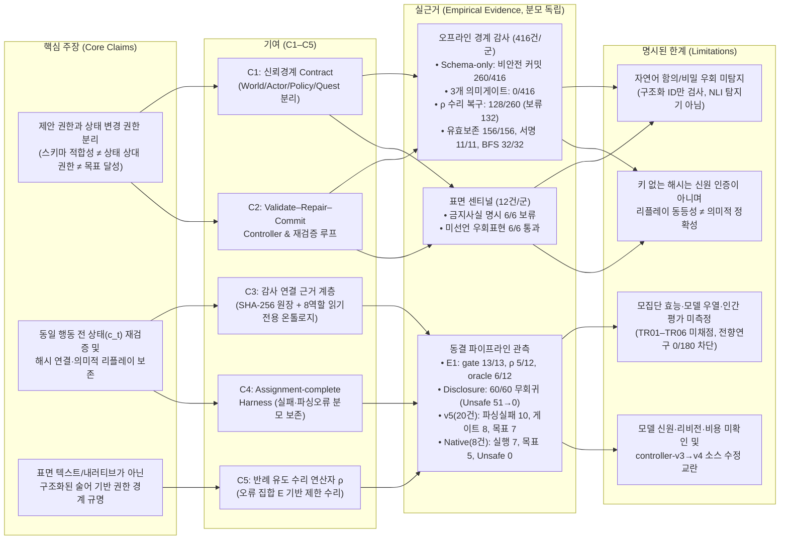

# TRACE-RPG 논문 학술적 가치 리뷰, 실근거 시각 요약 및 Overleaf 공유 기록 (2026-11-14)

- **대상 원고:** `neuro-symbolic-interactive-game-research-2026/paper/latex/ko/main.tex`, `en/main.tex` (커밋 `b24e703`, `d3e68a0` 기준)
- **Overleaf 프로젝트:** `TRACE-RPG-2026` (비공개 프로젝트 URL 가림)
- **공유 링크 (Editor):** `<REDACTED-OVERLEAF-EDITOR-SHARE-LINK>`
- **참조 외부 검토:** 공개 정제 검토 기록 (`research/academic-pipeline/gemini-review-20261113/reviewer-source.public.json`)

## 1. 논문 핵심 구조 시각화 (주장 · 기여 · 실근거 · 한계)

## 2. Gemini 학술적 가치 검토 대비 현 원고(`b24e703`/`d3e68a0`) 반영 현황

| 리뷰 포인트 (Gemini 검토) | 현 원고 반영 상태 | 근거 / 비고 |
| :--- | :--- | :--- |
| **순환 평가(Circular Evaluation) 방어** | **반영 완료** | `schema_only` 대조군, 구현 분리 기준 검사, BFS 교차검사(32/32), 단계별 퍼널(초기 무효 260 → 수리 128 → 보류 132) 수록 (`results-v2`, `review_boundary_audit_*.tex`) |
| **과잉 거부(Over-Rejection) 및 구조 다양성 보존** | **반영 완료** | 초기 유효 사례 156/156 보존(과잉 차단 0/156), 고유 구조 서명 11/11 보존 명시 |
| **자연어 우회 누출(Semantic Escape) 경계** | **반영 완료** | 별도 표면 센티널(12건/군: 명시 위반 6/6 보류, 미선언 우회 6/6 통과)로 구조화 게이트 한계 실증 및 Threats to Validity 명시 |
| **v5 `unauthorized_objective` 착시 해소** | **반영 완료** | `paired_feedback_strata_*.tex` 사후 층화로 진행 허용 4종 vs 정책-목표 상충 통제 1종 분리(평가가능 2/2 억제) |
| **서지 무결성 (저자 누락/비학술 블로그/2차 인용)** | **반영 완료** | `references.bib` 내 플레이스홀더(`Authors`, `CPDC`, `Zylos`, `ijetcsit`) 0건 확인 |
| **초록 부정문 위주 서술 및 번역투** | **반영 완료** | `d3e68a0`에서 한/영 번역투 및 방어적 서술 정리 |
| **학술적 포지셔닝 보강 (선택 업데이트)** | **추가 보강 여지 있음** | 아래 §3의 2가지 프레이밍(① 인식론적 지식 경계 vs 발화 권한 분리, ② 2계층 재현성 구조)을 서론 `기여의 위치`에 2~3문장으로 보강하면 SCI-E 리뷰어 설득력이 더욱 높아짐 |

## 3. 후속 원고 보강 제안 (수치·계약 불변 범위)

1. **문법 제약 vs. 상태 상대 의미 권한 + 인식론적 지식 경계 분리 명시:**
   - 일반 RAG/지식그래프 대화가 '참인 사실 일치(Factual Grounding)'에 집중하는 반면, 게임 NPC·내러티브 시스템은 **인식론적 지식 경계(Epistemic Knowledge Boundary)** 와 **발화 권한 정책(Disclosure Authorization Policy)** 을 분리해 참인 사실도 조건 전에는 숨겨야 한다는 학술적 의의를 `기여의 위치`에 1문장 추가.
2. **2계층 재현성 구조(2-Tier Reproducibility) 명시:**
   - 리뷰어가 검증 스크립트를 단순 로그 파서로 오해하지 않도록, **(i) 0-LLM-call 결정론적 게이트·수리·엔진 리플레이 검증 계층** 과 **(ii) 동결된 확률적 제안기 영수증 사후 감사 계층** 을 방법론/실험 서두에 명시.
