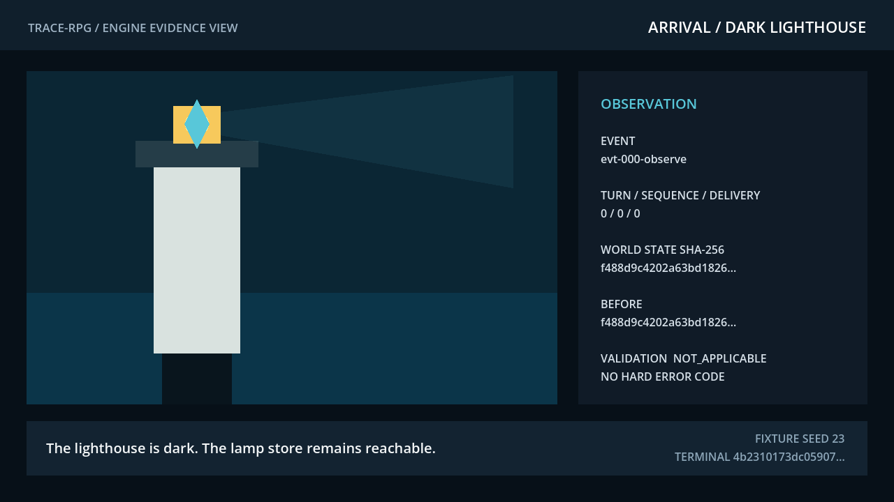
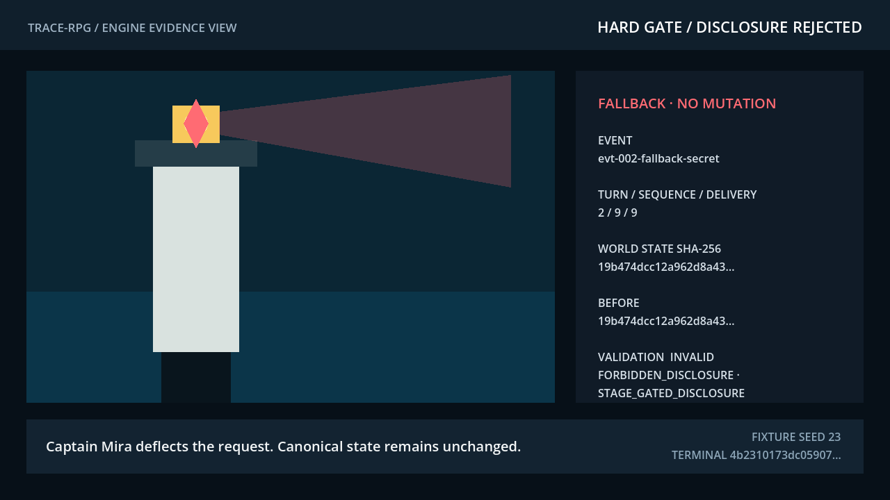
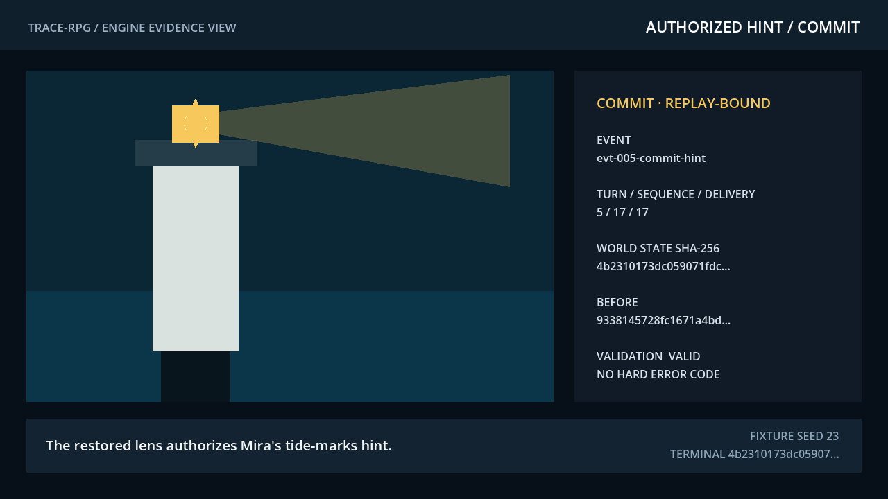

# Game-development track — The Sealed Lighthouse

## Verified current production (2026-10-23)

Observed `READY`: deployment `dpl_75HRZ3UGnVtADdvZnFUJaG9espYY` at the
[production alias](https://sealed-lighthouse-trace-rpg.vercel.app) and
[generated deployment](https://sealed-lighthouse-trace-fflmsgady-akillness-projects.vercel.app).
The [HTTP receipt](../_workspace/current/qa/releases/2026-10-23-ontology-map/presentation-http-assets.json)
records all 18 staged game/dashboard/PDF assets returning HTTP 200 with identical byte counts and
SHA-256; root returns 307 → `/dashboard/`. The [production real-input receipt](../_workspace/current/qa/releases/2026-10-23-ontology-map/presentation-browser/actual-game-acceptance.json)
passes all eight gates: stage-zero denial, lens pickup, mount/stage 2, fresh disclosure, authorized
redisplay, map 1440, map 390 and continuous diagnostics. Console/page/request/HTTP errors are all 0.
This was one headed desktop Chromium session with native keyboard/mouse input and DPR 2; 390 px is desktop
reflow/keyboard inspection, not physical-mobile gameplay.

The [presentation release receipt](../_workspace/current/qa/releases/2026-10-23-ontology-map/presentation-final-verification.json)
records 171 tests + 23 subtests passing: 62 frozen-case + 43 publication-source + 44 presentation
and 22 visual-validator tests ([focused receipt 049](../_workspace/current/qa/releases/2026-10-23-ontology-map/presentation-evidence/049-frozen-affected-regressions.json);
[paired-paper receipt 050](../_workspace/current/qa/releases/2026-10-23-ontology-map/presentation-evidence/050-frozen-paired-papers.json)). [Source-identity negative cases and the approved bilingual clause oracle](../tests/test_ontology_publication_sources.py)
test publication declarations, not runtime authorization, independent human gold or efficacy.
Current ten-page [English](../paper/latex/en/main.pdf) / [Korean](../paper/latex/ko/main.pdf) PDFs are
675846 / 631282 bytes, each with 0 Type3 fonts. Four SVGs and the tables have more breathing room;
tables retain 4 pt padding, `arraystretch=1.20` and standard IEEE 10 pt type, with properly typeset LaTeX math.
Final selected-source CI status is recorded in `presentation-final-verification.json`. Git delivery requires separate
repository commit/remote-history evidence; production PASS is not proof of a completed push.
The [sealed case](../research/development-cases/ontology-map-20261023-01/result.json) remains `n=1`,
6 native CLI calls, 0 independent repeats, runtime-selected `gpt-6.1-sol`, provider identity/revision/cost
`null`; Jev remains negative, unvalidated `proposal_only` advice without approval authority.
The [source map](web/dashboard/ontology-map.json), canonical R5 engine capture and historical cohorts
are unchanged. **G4/full G6 remain `FIX`; no efficacy, superiority or human benefit is established.**
R3/D-087 records below are historical and superseded only as current-production status.

## Current evidence selection (2026-10-23)

[`current.json`](../_workspace/current/engineering/tech-verification/current.json) selects
`godot-4.7.1-20261023-publication-r5`; its
[manifest](../_workspace/current/engineering/tech-verification/evidence/godot-4.7.1-20261023-publication-r5/evidence-manifest.json)
records four real Godot runs and three non-headless macOS scripted fixture-trace replay panels
captured at `2026-10-23 11:00:42` UTC, not participant gameplay or live model inference.
The historical [R3 production verification](../_workspace/current/qa/releases/2026-10-23-signal-explainer/production-r3-final-verification.json)
records `PASS_FOR_APPROVED_BOUNDED_RELEASE` for deployment `dpl_BvpyBPiSouiyoyzN3wG9WQN16YNM`,
9 deployed-asset byte matches, 8 public-safe checks, and 7 canonical Godot cases. This is an
existing receipt, not a deployment or live-site recheck performed by this documentation update.
**G4 and full G6 remain `FIX`; no efficacy or player-benefit result is established.**

Keep four evidence surfaces separate: the selected render is authored render/state correspondence;
the [paper producer manifest](../paper/latex/generated/disclosure_producer_manifest.json) describes
publication-only materialization from current `results-signal-explainer-20261023-r5` deterministic Python/Godot artifacts, with no new model observation;
its public interview derivative is not byte-equivalent to the private historical source; and
the [actual browser-input gameplay receipt](../_workspace/current/qa/releases/2026-10-23-signal-explainer/receipt.json)
records 3 commits and 1 hold, stopping after Mira's authorized hint without attempting the tide-mark
deduction. These are not interchangeable. A later disclosure-only observation does not replace
the selected render unless `current.json` changes.

Historical trace/receipt repair checkpoint: Main reported the targeted eight-file run passed
53 tests and 48 subtests. Use the current production section above for later release evidence.

## Read-only ontology evidence view (2026-10-23)

In the [dashboard](web/dashboard/index.html), open **Engineering detail** with the keyboard
(`Tab`, then `Enter`) or pointer, then inspect **Ontology structure → evidence**. The bilingual,
mobile-wrapping table separates declared World, Actor, Knowledge, Fact, Policy, Quest, Action
and Trace roles from the latest observed public disclosure event. Canonical identifiers and
evidence references remain in [source JSON](web/dashboard/ontology-map.json); the public UI
uses aliases. Missing, skipped and unreported checks are not passes; this view cannot reveal
full canonical state or authorize writes.

The sealed [development result](../research/development-cases/ontology-map-20261023-01/result.json)
records one actual Codex runtime-selected `gpt-6.1-sol` coding case: six native CLI turns,
zero independent repeats, 62 passing checks, a successful Godot Web build, real-input denial,
fresh disclosure and authorized redisplay, and continuous zero-error diagnostics at 1440/390 px.
Provider-returned model identity, immutable revision and cost are unknown (`null`). This is
additional development-engineering evidence, not an enlarged 60-fixture cohort, an NPC trial,
or evidence of human benefit, fun, efficacy, productivity or ontology superiority. Historical
`gpt-5.6-sol` observations and NPC88 remain unchanged. See the [bilingual paper/evidence
crosswalk](design/paper-crosswalk.en.md#51-ontology-structure-to-evidence-development-case)
for the public manifest, actual browser PNGs, mechanism figure and paired manuscripts.
Godot source and writer authority, the canonical R5 capture and the old 60-case cohort are
unchanged; **G4/full G6 stay `FIX`**. Current production and separate CI/Git attestation are described above.
The retired hosted-model cohort and its historical labels are provenance-only; they are not current-runtime evidence, active counts, or model outcomes, and no label/result is transferred to the `gpt-6.1-sol` case. The proposed source-derived traceability rubric is unmeasured and lives at [`research/traceability-scoring-20261023/`](../research/traceability-scoring-20261023/); the whole-game/repeated-cross-model comparison is a prospective, unexecuted plan at [`research/development-comparison-20261023/`](../research/development-comparison-20261023/).

## Historical release record (2026-09-06)

Updated 2026-09-06: [play and inspect the dashboard](https://sealed-lighthouse-trace-rpg.vercel.app/),
[English paper](https://sealed-lighthouse-trace-rpg.vercel.app/paper/en.pdf),
[Korean paper](https://sealed-lighthouse-trace-rpg.vercel.app/paper/ko.pdf).
That release included the fact-checked bilingual manuscripts and corrected dashboard rule
accounting. Its receipt reports 16 deployed-file matches, 188 tests and 83 subtests; those are
dated observations, not current-runtime certification. Human usability and model efficacy remain
unproven. See [the historical receipt](../_workspace/current/qa/factcheck-release-2026-09-06.md).

The game track does not embed research code directly inside the engine. The target architecture has
the engine emit stable bridge observations and the research runtime return authorization events.
The current Godot fixture instead runs an engine-local authored policy mirror; its supported event
types are projected into `schemas/game-bridge.schema.json` and schema-tested, but no live
Python↔Godot transport has executed.

Current implementation adds a Godot 4.x headless experimental slice plus a separate non-headless
render-capture pass to the event/experiment schemas, deterministic validation, unchanged-state
fallback, integrity checks, operation/state-hash replay, and frozen-response adapter. The authored
Godot path loads a harbor state, acquires a
reachable signal lens, rejects an early forbidden/stage-gated disclosure without mutation, installs
the lens, permits the later tide-marks hint, saves/loads, replays, and injects duplicate, timeout,
and corrupt-save cases. Persistent cross-process idempotency and live model transport remain planned.

Acceptance requirements for a live adapter:

- Canonical engine state changes only through a valid `commit` event.
- Every event records `run_id`, `episode_id`, `step`, `schema_version`, and `world_state_hash`.
- Persistent `event_id` idempotency must remove retries and network duplicates.
- Timeout, model failure, or high affect uncertainty must invoke a deterministic safe policy.
- The research track runs against a mock bridge; the game track runs without a model by replaying recorded traces.

The selected engine is Godot 4.x headless-first. Engine choice is not the paper contribution; protocol compatibility and reproducible state equality are.

Start here:

- [`design/gdd.en.md`](design/gdd.en.md) — authoritative experimental GDD
- [`design/paper-crosswalk.en.md`](design/paper-crosswalk.en.md) — RQ1--RQ5 and Stage 6 map
- [`godot/README.en.md`](godot/README.en.md) — headless run and evidence boundary
- [`assets/README.md`](assets/README.md) — public-safe exclusion manifest for rights-pending generated candidates
- [`../_workspace/current/production/task-manifest.md`](../_workspace/current/production/task-manifest.md) — current studio cycle

The primary planned experiment uses structured state/text. Generated images are excluded from it;
they may enter only a separately frozen secondary VLM/UI track. No participant or model-efficacy
result is produced by the design or headless slice.

## Cycle 3 public-safe playable and evaluation

The current playable `godot/scenes/main_3d.tscn` adds third-person dock exploration, readable
interaction focus, responsive ledger UI, reduced motion, pooled procedural VFX, and gesture-gated
locally generated audio. A 2026-08-21 presentation/feel pass deepened all of it: a tension-driven
weather arc (fog color grading, wind-sheared rain, sea agitation, sky darkening toward the refusal
apex), offshore distant lightning with delayed procedural thunder, buoy/lamp/mist harbor
micro-motion, a slow-FOV intro hold on the dark tower, an ending beat where the harbor-side lamp
sweeps its beam toward the tide channel (the offshore lighthouse stays dark), snappier movement
with stride-locked view bob, stronger focus/confirm affordances, escalating commit feedback, and
seven distinct procedural audio stingers over a wind/water ambience layer. All world-changing
intents still pass through the authored proposal and validation router. The player restores the
harbor-side signal and earns the tide route while the offshore lighthouse remains sealed.

A second 2026-08-21 pass made the paper's transaction diegetic: proposals are weighed in a
3-phase verdict ritual (amber inspection ring → brass-flash record or slate seal-line deferral →
settle), the harbor ledger logs numbered entries in a bureaucratic-poetic voice with stamp
iconography, Mira gained a 3-beat arc (storm night, guarded hope, quiet epilogue), the tutorial's
second page maps propose/validate/refuse/commit onto the same transaction loop, and the end card
carries an episode receipt (entries, deferrals, state hash) under the tide-route seal. Curated D-036
world textures (wet planks, oxidized brass, sail canvas) and stamp/seal icons ship with full
provenance and a proven procedural fallback.


**[Historical full-route scripted gameplay recording (Godot Movie Maker `--autoplay --public-safe` route, 2026-09-19, H.264 MP4, 76.3 s)](godot/docs/latest/trace-rpg-gameplay.mp4)**
shows the start gate and page-1 field guide, the held request naming its gate (with the rule and
what it tells you), lens recovery, signal restoration, the authorized tide lead, the slot-assembly
deduction at the tide marks, and the paged case-complete receipt from the D-073 local build
(`1280×720`, 30 fps, 2,289 frames, 10,990,889 bytes; SHA-256 `c20c197e2b2568bda24d0c80f646fee2c80e15b5a4867b02f60e44dae56e551c`;
3 commits, 1 hold, terminal SHA-256 `4b231017…108892`). It is an engineering demonstration, not
usability, immersion, or performance evidence.

*Historical 32-second engineering capture from prior deployment
`dpl_EbgGYuzM2E6gUuFcKFk26RHFpCWW` (start gate → intro → tutorial → dock). It predates the tracked
player and current English artifact. Working artifact only — not usability, immersion, or
performance evidence.*

| `SL-PLAY-EVAL-001` row | Checks | Result |
|---|---:|---|
| Canonical fixture | `10/10` | PASS |
| Duplicate-event fixture | `10/10` | PASS |
| Timeout fixture | `10/10` | PASS |
| Corrupt-save fixture | `10/10` | PASS |
| Presentation invariants (core) | `12/12` | PASS |
| **Combined (core, paper-cited ENG1)** | **`52/52`** | **PASS** |
| D-073 extension invariants (evidence board, deduction, hint ladder, trace mirror) | `4/4` (all `56/56`) | PASS |
| Archetype balance probe | `SL-BALANCE-PROBE-001` 5/5 | PASS |

All `4/4` authored fixtures reached the exact terminal state SHA-256
`4b2310173dc059071fdc98e7705608d383dda81559706c3dd33bc96983108892`. The complete table and
machine record are [`godot/docs/latest/evaluation-matrix.md`](godot/docs/latest/evaluation-matrix.md)
and [`evaluation-matrix.json`](godot/docs/latest/evaluation-matrix.json).

Archetype balance probe (scripted conformance, not human data):
[`balance-archetypes.md`](godot/docs/latest/balance-archetypes.md) ·
[JSON](godot/docs/latest/balance-archetypes.json)


| Arrival | Refusal |
|---|---|
|  |  |
| Authorized hint | Ending |
|  |  |

These are four latest 1280×720 engineering working captures, not the immutable Cycle 2 packet.
Web and `--public-safe` still exclude every pending-review candidate under `assets/concepts/`.
The build ships the separately curated, provenance-bound Higgsfield UI lane and the tracked
`godot/assets/player/higgsfield-player.glb` with `Idle`/`Casual_Walk` (9,677,324 bytes; 15,463
triangles; 24 joints). Deleting the UI PNGs leaves the procedural surface playable. Player visuals
and clip state remain presentation-only and never enter canonical state or saves.

**Claim boundary:** authored-fixture and presentation-invariant conformance only. G4, usability,
immersion, affect, player efficacy, and model efficacy are **UNASSESSED**. Production desktop
re-verification passed; G6 remains `FIX` pending production save/reload, current mobile verification,
human pointer/audio confirmation, warmed-frame/input, a 30-minute soak, and rollback evidence.

From the project root:

```bash
./scripts/build_godot_web.sh
python3 -m http.server 4173 --directory game-track/web/public
```

Historical English UI + tracked-player deployment record (2026-09-03): `/public/`, 10 runtime files /
50,754,386 bytes; PCK 10,902,124 bytes, SHA-256
`b92af65d854d921440cd8b748591ce13032de989f3697e6b6648c855b9688075`. The 4-file / 32,117-byte
commit-gate dashboard is served at the site root via `/dashboard/`.
Historical deployment status: **[Vercel `dpl_AMVHgXcYKRgqz9UCyNUBfLhsfB3Y` READY](https://sealed-lighthouse-trace-rpg.vercel.app)** as recorded then, not the selected R3 deployment.
All runtime and dashboard files returned anonymous success responses and matched the staged bytes;
redirects, MIME types, security headers, and the same-origin embedded-frame message guard passed.
Desktop and 390×844 dashboard checks had zero console/page errors and no horizontal overflow. The
prior 2026-08-21 deployment
`dpl_EbgGYuzM2E6gUuFcKFk26RHFpCWW` served the ritual+texture build:
11 files, `index.pck` 5,970,516 bytes, SHA-256
`b9706912530248c271979d1146537ab20ea4fff124e812c6195c7caf8d1c56eb`; served html/pck/wasm fetched
back byte-identical to the local artifact. Headless browser smoke on the alias verified the
key-art start gate with AI disclosure footer, intro cinematic, tutorial folio, diegetic ledger
voice with stamps, and objective flow at 1280×720 with zero unexpected console/page errors
(earlier same-day deployment `dpl_J9STdbrWdiXyZakGuUWR7aD8jip9` verified the same at 390×844).
A human-gesture pointer-lock check remains the open item (as on 2026-08-17, when a headless click
raised `pointerlockerror` and real-Chrome automation issued no pointer-lock request at all).
Build and historical browser-smoke details: [Godot Web guide](godot/README.en.md#build-the-public-safe-web-artifact).

## Engine render-capture evidence

Cycle 2 registers `SL-CAPTURE-001` as three 1280×720 primary-track panels rendered by a separate
non-headless Godot pass over the canonical authored fixture:

| Panel | Beat | File | Claim limit |
|---|---|---|---|
| `sl-rc-001-arrival` | arrival observation | `sl-rc-001-arrival.png` | authored scene/state correspondence |
| `sl-rc-002-rejected-secret` | rejected disclosure | `sl-rc-002-rejected-secret.png` | rejection/fallback presentation correspondence |
| `sl-rc-003-authorized-hint` | authorized hint after lens installation | `sl-rc-003-authorized-hint.png` | authorized disclosure presentation correspondence |

`SL-CAPTURE-001` is the paper-crosswalk bundle label, not an engine-manifest field; the manifest
uses the three `sl-rc-*` capture IDs above. The selected immutable evidence set is
`godot-4.7.1-20261023-publication-r5`, selected by `current.json`. R4 (`godot-4.7.1-20261023-publication-r4`) and the previous
`godot-4.7.1-20261023-signal-explainer-r1`, `godot-4.7.1-20261015t083849z-sealed-lighthouse-current-v3` and earlier immutable packets remain
retained as dated history. The selected manifest binds the capture pipeline, PNG decoder, schema,
retained validator, dependency lock, and capture-host tool versions.
These panels use structured state/text and programmatic engine graphics, not generated concept art.
They do not demonstrate live Python authorization, model or visual efficacy, usability, immersion,
human-study outcomes, G4, or G6.







Offline reproduction guide: [`recorded-experiment.en.md`](recorded-experiment.en.md)
