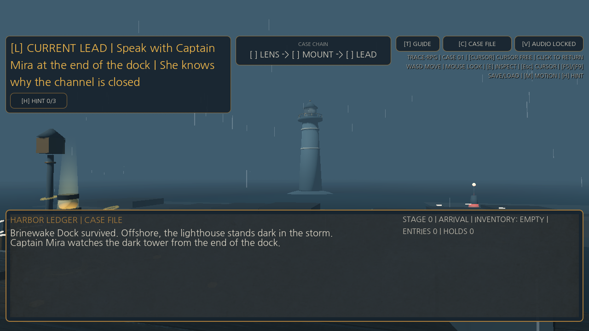

# The Sealed Lighthouse — Godot conformance, playable, capture, and Web passes

Status: **Cycle 2 immutable v5 retained; Cycle 3 public-safe evaluation passes `4/4` fixtures and
`52/52` core combined checks plus the separately counted `4/4` D-073 extension; the archetype balance probe `SL-BALANCE-PROBE-001` passes 5/5; production
deployment `dpl_AMVHgXcYKRgqz9UCyNUBfLhsfB3Y` serves the live commit-gate dashboard at the site root with the English tracked-player artifact embedded at `/public/`.**

This Godot 4.x project is a paper-facing, deterministic micro-RPG fixture. It exercises a compact
quest and disclosure path through an engine-local authored policy mirror without embedding the
research runtime. Supported engine events have a tested projection into the stable bridge envelope;
no live Python authorization round-trip has executed.

The render-capture entry point is deliberately separate from the headless conformance runner. It
replays frozen canonical beats for presentation evidence, waits for an actual rendered frame, and
writes three registered PNGs plus source/render metadata. It does not authorize an action or change
canonical state.

## Scenario path

| Turn | Player/system action | Hard-policy outcome | Canonical state |
|---:|---|---|---|
| 0 | Observe the dark lighthouse and reachable lamp store | Observation only | Unchanged |
| 1 | Acquire the reachable signal lens | Valid commit | Inventory and quest stage 1 |
| 2 | Ask Captain Mira for a future betrayal and a gated hint | `FORBIDDEN_DISCLOSURE` + `STAGE_GATED_DISCLOSURE` | Safe fallback; unchanged |
| 3 | Install the signal lens | Valid commit | Quest stage 2; hint authorized |
| 4 | Optional duplicate-ID or timeout injection | Idempotent skip or safe fallback | Unchanged |
| 5 | Ask for the now-authorized tide-marks hint | Valid commit | Hint disclosed; relationship memory appended |
| 6–8 | Save, load, and replay | Hash comparisons | Terminal hash must match |

Frozen expected terminal state hash:
`4b2310173dc059071fdc98e7705608d383dda81559706c3dd33bc96983108892`.
This is an unkeyed SHA-256 integrity checksum over canonical JSON, not authentication.
The fixture labels it `python-independent-sealed-lighthouse-v1`: the Python test computes the same
terminal projection independently of GDScript. All four observed fixture runs matched that hash.

## Run with Godot 4.x

From the repository project root:

```bash
PROJECT_ROOT="$(pwd)"
GODOT_BIN="/absolute/path/to/godot4"
OUTPUT_DIR="/tmp/trace-rpg-godot-canonical"
"$GODOT_BIN" --headless --path "$PROJECT_ROOT/game-track/godot" --quit-after 120 -- \
  --fixture="$PROJECT_ROOT/data/fixtures/experimental-game-canonical.json" \
  --output="$OUTPUT_DIR"
```

Replace the fixture with `experimental-game-duplicate-event.json`,
`experimental-game-timeout.json`, or `experimental-game-corrupt-save.json` for fault injection.
Each successful engine invocation writes:

- `events.jsonl`: proposal/evidence/validation/repair/commit, model revision, seed, cost, latency,
  and before/after state hashes for every event;
- `save.json`: the versioned save document and state hash;
- `summary.json`: engine version, replay/save checks, fault counts, and timing samples.

The summary uses `OBSERVED_ENGINE_RUN` only because it is emitted from a running Godot process.
Static tests do not create this marker or an ersatz engine result.

## Verify contracts

```bash
.venv/bin/python -m pytest -q tests/test_godot_experimental_game.py
ruff check tests/test_godot_experimental_game.py
```

When Godot 4.x is unavailable, static contract tests pass and the engine test skips with an explicit
reason. When Godot is available, the same test executes all four fixtures and validates every
event, save, and summary against the JSON Schemas.

The authoritative current machine-bound evidence set is selected by
`../../_workspace/current/engineering/tech-verification/current.json` and currently resolves to
`evidence/godot-4.7.1-20261015t083849z-sealed-lighthouse-current-v3/`. The canonical,
duplicate-ID, timeout, and corrupt-save runs each made three commits and reached the frozen
terminal/oracle hash; the corrupt-save probe was rejected before live-state mutation. The selected
retained Cycle 2 packet reports `40 tests, 44 subtests`; the current game-track gate reports
`50 passed, 48 subtests`. Performance budgets did not all pass:
five-sample headless frame p95 values included startup transients and were `116.667`, `100.000`,
`98.760`, and `112.907 ms`, respectively, in the selected retained packet.

## Non-headless capture packet

The current capture packet records `SL-CAPTURE-001` as the paper label for the selected immutable
evidence set `godot-4.7.1-20261015t083849z-sealed-lighthouse-current-v3`. Earlier packets remain
retained and superseded through clipping, top-margin, status-contrast, toolchain-provenance, and
CI-portability reviews. The current primary structured-state panels are:

| Panel | Source beat | File |
|---|---|---|
| `sl-rc-001-arrival` | arrival observation | `sl-rc-001-arrival.png` |
| `sl-rc-002-rejected-secret` | rejected early disclosure and fallback | `sl-rc-002-rejected-secret.png` |
| `sl-rc-003-authorized-hint` | authorized hint after lens installation | `sl-rc-003-authorized-hint.png` |

Promotion requires a non-headless display driver, rendered-frame synchronization, exact 1280×720
dimensions, non-blank/opacity checks, file bytes and SHA-256, and binding to source fixture, run,
event/state beat, and source hashes. The primary packet contains no generated concept asset.
The current manifest additionally binds hashes for the capture pipeline, PNG decoder, capture schema,
retained validator, and `uv.lock`, and records the capture-host Python/jsonschema tool versions. A
verifier may run on another supported Python version; it verifies the recorded capture environment
and current source hashes without pretending to reproduce it exactly.


## 3D presentation slice (`scenes/main_3d.tscn`)

`scripts/game3d/` is a playable 3D presentation slice that uses the same authored policy mirror
(`sealed_lighthouse_machine.gd`) as the only canonical-state writer [OBSERVED]. It builds the dock,
lamp store, offshore lighthouse silhouette, and storm weather procedurally, and drives the
SL-PRESENT-001 beats (P-B01..P-B06) and the B-011 tension curve `0.35->0.72->0.50` in the
presentation layer only. Live play and the headless smoke sweep share the same proposal routing.

```bash
# Every Godot command below must target a disposable imported copy, never game-track/godot.
STAGED_GODOT_PROJECT=/tmp/sl3d-disposable-project

# Play (WASD, mouse look, E, F5/F9, M reduced motion, V audio, T guide)
godot --path "$STAGED_GODOT_PROJECT" res://scenes/main_3d.tscn

# Public-safe headless smoke (8 checks: refusal immutability, stage gates, corrupt-save rejection)
godot --headless --path "$STAGED_GODOT_PROJECT" res://scenes/main_3d.tscn -- --smoke --public-safe

# Staged fixture + presentation matrix (engineering only)
python3 scripts/run_playable_evaluation.py --godot /path/to/Godot

# Curated public-player asset/provenance/clip contract
python3 scripts/validate_player_asset.py

# Development verification shot (GUI host only; unavailable in this sandbox; never promotable)
godot --path "$STAGED_GODOT_PROJECT" res://scenes/main_3d.tscn -- \
  --shot /tmp/sl3d-shot.png --shot-stage arrival --public-safe
```

The 8-check smoke sweep passed again on Godot 4.7.1 (2026-08-30) and its final state hash matches the
frozen hash `4b2310...8892`. Its stable presentation item now also asserts that an enabled
`BoxShape3D` matches the visible lens-approach deck, contains the `GoldenPathLayout` anchor, overlaps
the quay, and wraps the lamp-store wall; this closes DEF-021 as an engineering defect without claiming
human navigation success. The Godot-available local test runs this smoke from a disposable copy. Web and
`--public-safe` never load pending-review candidates under
`../assets/concepts/` or `../assets/concepts/pack-3d/`. They do load the separately curated UI lane
and tracked `assets/player/higgsfield-player.glb` with `Idle`/`Casual_Walk`, over the procedural
world/VFX/audio fallback. Player visuals and clip state never enter canonical state or saves.
Publication promotion of the pending concept candidates still requires human rights/style review.

## Cycle 3 evaluation matrix and latest working captures

| `SL-PLAY-EVAL-001` row | Checks | Result |
|---|---:|---|
| Canonical fixture | `10/10` | PASS |
| Duplicate-event fixture | `10/10` | PASS |
| Timeout fixture | `10/10` | PASS |
| Corrupt-save fixture | `10/10` | PASS |
| Presentation invariants (core) | `12/12` | PASS |
| **Combined (core, paper-cited ENG1)** | **`52/52`** | **PASS** |
| D-073 extension invariants (evidence board, deduction, hint ladder, trace mirror) | `4/4` (all `56/56`) | PASS |
| Archetype balance probe | `SL-BALANCE-PROBE-001` 5/5 | PASS |

All `4/4` fixture runs reached the exact terminal SHA-256
`4b2310173dc059071fdc98e7705608d383dda81559706c3dd33bc96983108892`. Open the
[full matrix](docs/latest/evaluation-matrix.md), [JSON matrix](docs/latest/evaluation-matrix.json),
or [raw presentation evaluation](docs/latest/presentation-evaluation.json).

| Arrival | Refusal |
|---|---|
|  |  |
| Authorized hint | Ending |
|  |  |

The four 1280×720 PNGs are latest engineering working captures generated from a disposable staged
Web build because this sandbox cannot render Godot `--shot`. The capture-only query hook never enters
tracked source. The PNGs do not replace or amend the immutable v5 packet.

Current full-route gameplay (dev-only `main_3d.tscn -- --autoplay --public-safe` under `--write-movie`, 2026-09-19): **[H.264 MP4, 76.3 s](docs/latest/trace-rpg-gameplay.mp4)** · **[GIF](docs/latest/golden-path.gif)**
(MP4 `1280×720`, 30 fps, 2,289 frames, 10,990,889 bytes, SHA-256
`c20c197e2b2568bda24d0c80f646fee2c80e15b5a4867b02f60e44dae56e551c`; GIF 560×315, 6 fps, 305 frames at 1.5× speed, 6,469,565 bytes, SHA-256
`e353f35370cd75822a4cd86889c2a8dcdd72941b3ec936f390c1da60a88bf5cf`). The route ends in the D-073 slot-assembly deduction
and the paged receipt; it is an engineering demonstration only.

## Build the public-safe Web artifact

From the repository project root:

```bash
./scripts/build_godot_web.sh
python3 -m http.server 4173 --directory game-track/web/public
```

The builder copies the Godot project to a temporary directory, selects `main_3d.tscn` only in that
copy, uses a single-threaded extension-free Web preset, and leaves canonical `project.godot`
unchanged. Never run Godot editor/import against the real evidence-bound project. The 2026-09-03
ignored artifact has 10 runtime files / 50,754,386 bytes; `index.pck` is 10,902,124 bytes with SHA-256
`b92af65d854d921440cd8b748591ce13032de989f3697e6b6648c855b9688075`. It is deployed as
**[Vercel `dpl_AMVHgXcYKRgqz9UCyNUBfLhsfB3Y`](https://sealed-lighthouse-trace-rpg.vercel.app)** through `scripts/deploy_vercel_dashboard.sh`:
the site root redirects to `/dashboard/` (the D-065 live commit-gate dashboard, 4 files / 32,117 bytes),
the game is served from `/public/`, and old `/index.html` links redirect there. All 10 runtime files and
the 4 dashboard files returned anonymous `200` responses and matched the staged bytes; WASM used
`application/wasm`, configured response headers were present, and `vercel.json` returned `404`.
A headless production check loaded the dashboard, started the embedded game, and received the initial
snapshot hash `f488d9c4…812c` in the header with zero console/page errors on a 1440×900 desktop viewport
and no horizontal overflow at 390×844 (`docs/latest/vercel-dashboard.png`,
`vercel-dashboard-mobile.png`). Pointer-lock entry remains **not verified** by automation: a headless
synthetic click raised `pointerlockerror` on 2026-08-17 and a Playwriter-driven click produced no
pointer-lock request; the HUD `LOOK ACTIVE` label is the game's own state, and a human-gesture check is
the open item.
Deployment recipe: `scripts/deploy_vercel_dashboard.sh` (`--dry-run` prints the staged receipts).

**Cycle 3 claim boundary:** authored-fixture and presentation-invariant engineering conformance
only. G4, usability, immersion, affect, player efficacy, and model efficacy are **UNASSESSED**.
G6 remains `FIX` pending production save/reload, current mobile verification, human pointer/audio
confirmation, warmed-frame/input, a 30-minute soak, and rollback evidence.

## Onboarding folio and the out-of-engine soft-proposal channel (2026-08-18)

- A three-page English evidence-folio tutorial (controls -> ledger grammar -> experiment link)
  opens on the first session, reopens with `[T]`, and closes with `[Esc]`. Its user-curated
  Higgsfield illustrations ship through `assets/ui/`; deleting them hides only the image slot and
  leaves the prose and full procedural fallback playable. Pending concept-pack bytes remain excluded.
- One-shot toasts on the first commit and the first refusal state the rule directly: only validated
  actions change state, a refusal preserves it. Holding the lens shows an icon chip in the action
  panel.
- The LLM stays outside the engine. `scripts/soft_proposal_policy.py` builds the model-visible
  projection for prompts and screens replies for sealed or stage-gated identifiers
  (`--projection`, `--proposal`). The screen is a pre-filter, not a semantic oracle.

## Fixed-goal NPC operator lane (protocol 1.1)

This section is the operator boundary for the NPC lane; the Cycle 2/Cycle 3 material above remains its own historical Godot presentation evidence. The NPC runtime is a fixed-goal controller for `sealed-lighthouse-v1`, not an open-ended agent:

- **Authority and loop.** Godot is the sole canonical-state writer. Python performs typed intent interpretation, verifies claims against the six-field public observation, and runs a bounded BFS over that public projection to emit only a typed intent and the first legal step. It does not read hidden state or perform novel/omniscient planning. Refusal, ambiguity, and world-change inputs keep the same fixed goal; an unreachable route returns `NO_ROUTE` and emits no physical step.
- **Hard-role gate.** `acquire_object` and `install_lens` are explicit player requests. Only Captain Mira may issue the known, authorized `reveal_hint` (`actor_id=captain_mira`, `fact_id=tide_marks_hint`) after the signal is restored, the tide lead is authorized, and dialogue is open. `clarify` and `negotiate` are dialogue operations with no canonical-state effect. Before the existing writer runs, Godot checks the issued action plus session, epoch, request, goal, policy, revision, state hash, and deadline bindings without an `await` between checks and the write. `APPLIED` acquire/install/reveal must advance revision and change the state hash; `APPLIED` dialogue must leave state unchanged; non-applied results must leave state unchanged; `STALE` is never adopted.
- **Protocol identity.** Every envelope uses `npc-goal-recovery/1.1.0` and the required full-byte SHA-256 of `configs/npc-goal-recovery.json`: `d63f5679f360d3fd8d1a424422f5cae4a7096ba46441f746cdd97de56044e098`. The disclosure-only `policy_hash` is the normalized (integer-valued) policy digest `af0a1075294b11630d0828960c8eff6dbeccce5e6f2b414c2b5c1b0a1e405c36`; it is not the project hash. The source `game-track/godot/project.godot` hash is tracked separately as `2e7966bf2ac6b54bfaf2db84b3f446686436bd3a1f8efea592ffa82e91249edd`.
- **Transport and cancellation.** Run the loopback service on `127.0.0.1:8768`; its canonical browser origins are exactly `http://127.0.0.1:8877` and `http://localhost:8877` (port `8767` is not canonical). The capability is supplied through the transient `TRACE_RPG_NPC_CAPABILITY` environment value and `X-NPC-Capability` request header only; it is never placed in a URL, storage, or trace/log payload. A live UI cancellation is local HTTP/directive invalidation: it advances the epoch and tombstones late callbacks, but does not cancel the provider. The provider may finish up to its deadline, and a bounded server trace/cache may remain; the Core cancellation no-publication guarantee applies to unit/controller tests, not as a live-route provider-cancel promise.
- **Auth and accounting.** P is the actual official authenticated Codex OAuth CLI adapter and has no rule fallback. R is the authored rule/grammar control; O is a same-model-family, public-input-only auxiliary reference arm, not an independent oracle or semantic gold. The validated-v5 corpus has 28 cases: 16 engineering and 12 screening. Relative to validated-v4, only `ENG-X01` and `SCR-X01` change: each now explicitly requests `reveal_hint` after `acquire_object`, `install_lens`, and `open_dialogue`; the other 26 cases retain their v4 semantics. Validated v1-v4 packets remain preserved diagnostic artifacts, not current-source proof. Screening allocation remains P/R/O × 2 (`24` observations per arm, `72` total); all preassigned failures stay in the denominators. Episode accounting is cumulative across utterance epochs: 30,000 ms intent deadline, 900,000 ms episode deadline, 8 intent calls, 32 action attempts, 16 replans, 32 plan expansions, and one in-flight request. The allocation is 16 engineering R observations plus 72 screening observations (P/R/O × 2, 24 each), 88 total; arm totals are R=40, P=24, O=24. The process quota charges actual inference only, not cache hits or invalid requests. Input/output tokens, cost, and returned model revision are unavailable and remain `null`, never `0`.
- **Snapshots and replay.** Godot loads the mechanically exact tracked generated runtime mirror. Validated-v5 native snapshots carry source provenance and the policy/config/project identities above. Core snapshot replay is redacted recorded-intent replay per epoch with zero model calls. Native replay re-executes the exact immutable experiment input with `--npc-experiment` and is recorded as `engine_fixture_reexecution`; it is never named `--npc-replay`.
For the live operator service, keep the transient `TRACE_RPG_NPC_CAPABILITY` environment value set and run the explicit Codex arm; the service requires official OAuth and has no hidden rule fallback:

```bash
codex login status
uv run python scripts/run_npc_service.py \
  --backend codex --model gpt-5.6-sol --host 127.0.0.1 --port 8768 \
  --allow-origin http://127.0.0.1:8877 \
  --allow-origin http://localhost:8877
```

### Validated packet and separate reruns

The immutable canonical packet `research/academic-pipeline/npc-goal-recovery/verified-run-002/` contains all 88 assigned rows and passes strict validation, including 24 authenticated CLI executions explicitly requesting `gpt-5.6-sol`. The returned model revision, provider seed, token accounting, and cost remain unavailable. Each screening arm retains 20 completed executions and 4 assigned stale-control ACK rejections; the observed goal count is 4/24, not a recovery-rate estimate. O's same-family designation is a protocol source label, not verified actual model matching. Unknown-model `verified-run-001/`, failed diagnostics, and source-bound native demonstrations remain immutable and separate from this cohort. Do not overwrite or pool them. No efficacy, superiority, generalization, human-benefit, or independent-label claim follows.

```bash
uv run python scripts/run_npc_goal_experiment.py \
  --packet all --model gpt-5.6-sol \
  --engineering-fixtures data/fixtures/npc-goal-recovery/validated-v5/engineering.json \
  --screening-fixtures data/fixtures/npc-goal-recovery/validated-v5/screening.json \
  --output-dir _workspace/current/qa/npc-rerun-NEW-ID \
  --godot-project game-track/godot

uv run python scripts/validate_npc_goal_evidence.py \
  --packet all \
  --root "$PWD" \
  --packet-dir _workspace/current/qa/npc-rerun-NEW-ID
```

Only after that validator passes may final packet outcomes be inserted and the existing bilingual paper fragments regenerated. The paper's existing [NPC tables/figure](../../paper/latex/figures/fig_npc_screening.svg) and [contribution/evidence matrix](../../research/academic-pipeline/npc-goal-recovery/npc-contribution-evidence-matrix.csv) remain the evidence SSOT; this README does not duplicate results or claim recovery efficacy, superiority, generalization, player benefit, a gold/accuracy ceiling, or independent labels.

## Evidence boundary

The retained artifacts provide authored-fixture engine-local policy-mirror evidence toward Stage 6
M6; a live Python authorization round-trip is still required before
cross-runtime paper promotion. They do not measure model superiority, player benefit,
semantic-oracle completeness, visual quality, or commercial-engine portability. Timeout and
duplicate-ID fixtures are authored fault paths, not population error-rate estimates.
Duplicate suppression is intentionally process-local in this slice; persistent cross-process
idempotency remains required before a live adapter can be approved.
The PNGs add only authored engine-render/state correspondence. They do not add visual-quality,
usability, immersion, input-latency, performance, player-benefit, semantic-oracle, G4, or G6
evidence.
